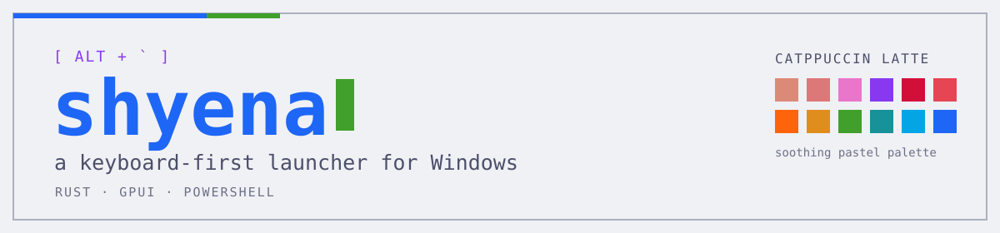

<div align="center">



**A keyboard-first launcher for Windows — apps, PowerShell automation, and system commands behind one hotkey.**

[](https://github.com/adityamotale/shyena/actions/workflows/tests.yaml)
[](https://github.com/adityamotale/shyena/releases)
[](LICENSE)
[](https://github.com/adityamotale/shyena)
[](https://github.com/adityamotale/shyena/forks)
[](https://github.com/adityamotale/shyena/issues)

[](https://www.microsoft.com/windows)
[](https://www.rust-lang.org/)
[](https://gpui.rs)
[](https://learn.microsoft.com/powershell/)
[](https://catppuccin.com/)

</div>

## What is Shyena?

Shyena is a small, always-on Windows launcher. Press <kbd>Alt</kbd> + <kbd>\`</kbd>, start typing, and hit <kbd>Enter</kbd>. It searches registered applications and PowerShell functions as you type, scopes results with `@`, `#`, and `:`, and runs the winner — apps spawn directly, PowerShell functions run on a transient worker thread.

It starts at login and stays resident behind a hidden 1×1 anchor window, so the hotkey never needs re-registering. Configuration is read once at startup and served from memory; no watcher threads, and no PowerShell process exists while idle.

## Features

- **One hotkey, everywhere** — global <kbd>Alt</kbd> + <kbd>`</kbd> toggles the launcher from any window.
- **Three scopes** — `@` for apps, `#` for PowerShell functions, `:` for built-ins, or no prefix to search apps and functions together.
- **Type-ahead and completion** — candidates rank by exact match, then prefix; <kbd>Tab</kbd> completes the selected candidate while keeping its scope for dynamic arguments.
- **Real PowerShell configuration** — `.shyena` is valid PowerShell: `Register-App` for fixed binaries, ordinary `function` declarations for dynamic arguments and multi-step automation.
- **Catppuccin themes** — Macchiato dark by default; switch to Latte with `Set-Theme 'light'`.
- **Quiet and lean** — ~200 µs config reload, transient PowerShell threads, and an idle working set trimmed into the low megabytes after dismissal.
- **Self-contained** — GeistMono Nerd Font is embedded in the binary; no system font install is needed.
- **Guided install and update** — the installer verifies SHA256 checksums and asks before each change; uninstalling keeps your config unless you ask otherwise.

## Install and update

Shyena supports Windows 10/11 (build 19041+), PowerShell 5.1+, and runs in a non-elevated user context.

Download and run the installer in an interactive PowerShell window:

```powershell
Invoke-WebRequest https://raw.githubusercontent.com/adityamotale/shyena/master/install.ps1 -OutFile install.ps1
Set-ExecutionPolicy -Scope Process Bypass
.\install.ps1
```

The installer prints a plan and asks before each mutating step. To preview without changing anything, use `.\install.ps1 -DryRun`. In non-interactive shells stdin is redirected, so pass `-Yes` to accept the defaults.

| Flag | Effect |
| --- | --- |
| `-DryRun` | Print the plan, make no changes, ask nothing. |
| `-Yes` | Accept every default (required when stdin is redirected). |
| `-Version <tag>` | Install a specific release tag instead of `latest`. |
| `-NoAutostart` | Skip the per-user autostart entry. |
| `-NoLaunch` | Do not launch Shyena after installing. |

The binary goes to `%LOCALAPPDATA%\Programs\shyena\shyena.exe`, an optional user `Path` entry and autostart key are added with your consent, and `~/.config/.shyena` is seeded **only if it does not already exist** — your config is never overwritten. **To update, simply re-run `install.ps1`.**

To remove Shyena, run `uninstall.ps1` the same way. It leaves `~/.config/.shyena` in place unless you pass `-PurgeConfig`.

## Quick start

Press <kbd>Alt</kbd> + <kbd>`</kbd> to open the bar, then type a key or a prefix:

| Input | Meaning | Example |
| --- | --- | --- |
| `@` | Registered application | `@terminal`, `@files C:\dev` |
| `#` | PowerShell function | `# volume 40`, `# uuid` |
| `:` | Built-in command | `:reload` |
| plain text | Search apps and functions together | `calc`, `stamp` |

Both `@app` and `@ app` forms work. Anything after the key is forwarded to the target as arguments.

| Key | Action |
| --- | --- |
| <kbd>↑</kbd> / <kbd>↓</kbd> | Move the highlighted candidate. |
| <kbd>Tab</kbd> | Complete the selected candidate (scope preserved). |
| <kbd>Enter</kbd> | Run the selection, or an exact key match. |
| <kbd>Esc</kbd> | Close the bar; from a command error, return to the search bar. |
| <kbd>Backspace</kbd> | Delete the last character. |

A failed command shows a one-line error panel; <kbd>Esc</kbd> clears it. A config error names the file to fix and closes on <kbd>Esc</kbd>.

## Configuration

The installed config lives at `~/.config/.shyena` (debug builds read the repository-root [`.shyena`](.shyena)). It is PowerShell source — comments are ignored and only declarations are read:

```powershell
Set-Theme 'light'       # 'dark' = Macchiato (default), 'light' = Latte
Set-Suggestions 'on'    # 'off' = exact key + Enter only, no dropdown

Register-App 'terminal' @{
    Path = 'wt.exe'
    Args = @()
}

function uuid { Set-Clipboard -Value ([guid]::NewGuid().ToString()) }
```

Edit the file, then run `:reload` in the launcher to pick up changes. Shyena never writes the config itself, and the installer seeds it only once. The shipped [`.shyena`](.shyena) has more examples for apps, media, clipboard, and system commands.

## Build from source

You need stable Rust (edition 2024, Rust 1.85+) and a Windows machine with the MSVC toolchain:

```powershell
git clone https://github.com/adityamotale/shyena.git
cd shyena
cargo build --release
```

Release builds are GUI-only; debug builds keep a console so `cargo run` can be interrupted with <kbd>Ctrl</kbd> + <kbd>C</kbd>, and read config from the repo root.

## Documentation

- [Architecture](docs/ARCHITECTURE.md) — process model, event flows, config pipeline, performance measurements, and extension points.
- [Smoke test](docs/SMOKE_TEST.md) — desktop-only checks for the global hotkey, DWM visuals, and real process launches.
- [Example config](.shyena) — the seeded `~/.config/.shyena`.

## Contributing

Keep the quality gates green before opening a PR:

```powershell
cargo fmt --all -- --check
cargo clippy --all-targets -- -D warnings
cargo test --all-targets
```

UI tests run headlessly through GPUI's `TestAppContext`, with Win32 and process spawning behind an injectable effects boundary. [ARCHITECTURE.md](docs/ARCHITECTURE.md#extension-points) lists the mechanical steps for adding a built-in command, config directive, or theme role.

## Acknowledgements

- [Catppuccin](https://catppuccin.com/) — the Latte palette used by the light theme and this README.
- [GPUI](https://gpui.rs) — the UI framework.
- [Geist Mono](https://github.com/vercel/geist-font) patched with [Nerd Fonts](https://github.com/ryanoasis/nerd-fonts) — embedded for crisp, monospaced glyphs.
- [global-hotkey](https://github.com/tauri-apps/global-hotkey) — cross-platform hotkey registration.

## License

MIT — see [LICENSE](LICENSE).
